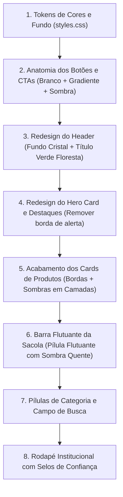

# Parecer Técnico de UI/UX e Diretoria de Arte: Laís Fit Já
**Auditoria de Design da Interface do Cardápio Digital**  
**Data:** 22 de Novembro de 2026  
**Ambiente Inspecionado:** `http://127.0.0.1:5174/` (Mobile Viewport 390 × 844 px e Desktop 1280 × 800 px)  
**Status do Projeto:** Funcionalidade técnica avançada, porém com **apresentação visual amadora e chapada**, incompatível com o padrão contemporâneo de gastronomia saudável e e-commerces de alto padrão.

---

## 1. Avaliação Executiva e Notas (0 a 10)

| Critério Visual & UX | Nota | Diagnóstico Resumido |
| :--- | :---: | :--- |
| **Cores & Harmonia Cromática** | **4.0 / 10** | A sobreposição de marrom escuro/preto sobre laranja cria um contraste agressivo de "placa de perigo/fita zebrada", destruindo a sensação de frescor natural e vida fit. |
| **Botões, Formato e CTAs** | **3.0 / 10** | O ofensor estético mais grave: botões 100% chapados, sem contorno/stroke, sem profundidade, sem sombra quente e com texto escuro opaco. |
| **Estrutura, Profundidade e Camadas** | **3.5 / 10** | Layout visualmente desabado. Cards brancos sobre fundo quase branco sem bordas nem elevação parecem "recortes colados" sem refinamento. |
| **Tipografia & Hierarquia** | **5.0 / 10** | `Nunito Sans` com pesos extremos (800/900) soa truncada e infantil. Falta escala editorial moderna e kerning profissional. |
| **Identidade de Marca ("Fit & Fresh")** | **3.5 / 10** | Não transmite sofisticação, sabor saudável ou valor agregado. Parece um projeto universitário de programação em vez de uma loja gastronômica apetitosa. |
| **Cabeçalho (Header)** | **4.5 / 10** | Bloco maciço de laranja chapado que pesa visualmente no topo e sufoca a primeira dobra. |
| **Rodapé (Footer)** | **4.0 / 10** | Textos soltos centralizados, sem acabamento institucional ou selos de confiança. |
| **MÉDIA GERAL DE DESIGN** | **3.9 / 10** | **Classificação: Protótipo Funcional Amador (Requer Redesign de Interface)** |

---

## 2. Diagnóstico Profundo: Por Que a Tela Está com "Cara Amadora"?

### A. O Erro Crítico do Texto Preto/Marrom sobre o Laranja
* **A Falha de Teoria Cromática:** O laranja (`#EA5A1C`) é uma cor quente de energia, apetite e ação. No design de interfaces gastronômicas (Sweetgreen, Chopt, Boali, iFood Gourmet, Daki), cores de ação quentes exigem **Texto Branco Puro (`#FFFFFF`)** com tipografia nítida (font-weight 600 ou 700) e leve espaçamento entre letras (`letter-spacing: 0.01em`). O branco atua como luz, iluminando a cor de fundo e tornando o botão um convite magnético ao clique.
* **O Efeito no Usuário Atual:** A sobreposição do texto marrom café escuro (`#28150D`) sobre o laranja satura a percepção visual com tons de "queimado", "barro" e "pesado". Em vez de transmitir comida saudável, leveza e vitalidade, passa a impressão de alerta industrial ou fast-food decadente.

### B. A Ausência de Contorno (Stroke) e Elevação (Sombras em Camadas)
* **O Problema do Flat Design Obsoleto:** A interface está adotando um estilo *flat* de 2013, onde tudo é uma caixa sólida monocromática sem contorno (`border: 1px solid transparent;`) e sem sombra.
* **O Padrão Moderno (Neo-Skeuomorphism / Soft UI):** Em 2026, elementos táteis precisam de:
  1. **Stroke milimétrico de acabamento:** Um traço interno ou borda sutil (`1px solid rgba(0, 0, 0, 0.08)` ou `box-shadow: inset 0 1px 0 rgba(255, 255, 255, 0.25)`) que dá o aspecto de "tecla física esculpida".
  2. **Sombra colorida projetada (Glow Difuso):** Um botão de compra contemporâneo usa sombra baseada na sua própria cor (`box-shadow: 0 4px 14px rgba(234, 90, 28, 0.3)`), criando volume sem sujar o fundo.
  3. **Gradiente tonal imperceptível:** Um botão profissional raramente usa cor 100% sólida plana; ele usa um microgradiente vertical de 3% a 5% de variação (luz em cima, tom ligeiramente mais denso embaixo), transmitindo acabamento nobre.

### C. Fundo Opaco e Falta de Separação de Superfícies
* O fundo atual `--page: #fafaf7` é um tom de papel envelhecido sem personalidade.
* Como os cartões de produto são brancos (`#FFFFFF`) e não possuem borda visível (`border-color: transparent;` no CSS do catálogo), os produtos se dissolvem no fundo. Não há limites claros de onde começa e termina cada produto.

---

## 3. Análise Item por Item da Tela do Cardápio

### 3.1 Cabeçalho (Header)
* **Situação Atual:** Faixa sólida laranja de ponta a ponta. Título em marrom escuro com logotipo circular branco e botões escuros com linha fina.
* **Por que parece amador:** Funciona como um "teto pesado". Parece um cabeçalho padrão de template inicial de CSS. O marrom escuro sobre o laranja causa conflito de matiz.
* **Como deve ser o Header Profissional:**
  - **Fundo Cristal / Clean:** Fundo branco puro (`#FFFFFF`) ou translúcido suave (`rgba(255, 255, 255, 0.94)` com `backdrop-filter: blur(12px)` e borda inferior imperceptível `1px solid rgba(0,0,0,0.06)`).
  - **Tipografia da Marca:** Título "Laís Fit Já" em Verde Floresta Nobre (`#15331C`), transmitindo natureza, saúde, pureza e equilíbrio.
  - **Botão da Sacola Superior:** Tratado como uma pílula arredondada sofisticada com fundo sálvia claro (`#EDF4EE`), ícone verde escuro e uma badge de contagem laranja vibrante com texto branco.

### 3.2 O Card de Destaque (Hero — "Coxinha fit")
* **Situação Atual:** Possui uma borda vertical grossa de 4px na lateral esquerda (`border-inline-start: 4px solid var(--primary)`).
* **Por que parece amador:** No design de sistemas, essa barra lateral é o padrão clássico de "caixas de aviso" ou "alertas de erro" (callouts informativos). Tratar o produto estrela da loja com estética de aviso de sistema é um grave equívoco de apresentação gastronômica.
* **Como deve ser o Hero Profissional:**
  - Card premium em destaque com fundo branco, cantos amplos de 18px e sombra suave em camadas.
  - Uma etiqueta flutuante no topo: pill badge com fundo laranja suave (`#FFF0E8`), texto laranja nobre e ícone de fogo ou estrela (`🔥 Mais Pedido da Semana`).
  - Imagem do produto maior, com destaque e respiro.
  - Preço em tipografia tabular nítida e botão de ação que se destaca como o centro de conversão da primeira dobra.

### 3.3 Barra de Busca e Categorias
* **Campo de Busca:**
  - Atualmente é um retângulo cinza com ícone e texto de busca cinza escuro.
  - *Melhoria:* Deve possuir fundo branco puro, sombra interna ultra-suave (`box-shadow: 0 2px 8px rgba(0,0,0,0.04)`), borda com `rgba(0,0,0,0.08)` e um ícone de lupa verde sálvia com foco laranja suave no preenchimento.
* **Pílulas de Categoria (`.category-nav`):**
  - *Ativa:* Atualmente tem fundo laranja com texto marrom escuro.
  - *Melhoria:* A pílula ativa deve ter fundo Verde Botânico (`#1B3D27`) com texto Branco Puro (`#FFFFFF`) e leve sombra difusa, ou Laranja com texto Branco. O verde na categoria reforça imediatamente a essência *Fit*.
  - *Inativas:* Fundo branco puro, borda sutil `1px solid rgba(0,0,0,0.07)`, texto cinza-chumbo nobre (`#4A554D`) e micro-hover suave.

### 3.4 Cards de Produtos da Lista (Marmitas e Lanches)
* **Tamanho da Foto:** Atualmente a foto tem apenas 76px. Comida saudável precisa ser vista com nitidez para despertar o desejo.
  - *Melhoria:* Expandir a miniatura para 88px × 88px com cantos arredondados de 12px e efeito de zoom sutil ao toque.
* **Contorno e Sombra do Card:**
  - O card de produto precisa de contorno nítido: `border: 1px solid rgba(22, 51, 0, 0.08);`.
  - Sombra sutil: `box-shadow: 0 2px 6px -1px rgba(0, 0, 0, 0.03), 0 8px 16px -4px rgba(22, 51, 0, 0.04);`.
* **Badge "Queridinho":**
  - Hoje aparece como um texto cru verde perdido no meio da descrição.
  - *Melhoria:* Badge estruturada em estilo pílula com fundo verde menta sutil (`#E8F5E9`), texto verde escuro (`#1B5E20`) e cantos 9999px.

### 3.5 Anatomia dos Botões de Ação ("Escolher", "Adicionar à Sacola", "Revisar Pedido")
* **O Formato:**
  - Cantos: migrar de 12px rígidos para **14px orgânicos** ou **formato pílula (9999px)** no caso de botões de ação direta.
* **A Estrutura de Borda (Stroke):**
  - Aplicar borda de refinamento: `border: 1px solid rgba(0, 0, 0, 0.08);` e um brilho superior interno `box-shadow: inset 0 1px 0 rgba(255, 255, 255, 0.3);`.
* **A Cor e o Gradiente:**
  - Gradiente solar sutil: `linear-gradient(180deg, #F06423 0%, #E25010 100%)`.
  - Cor do texto: **`#FFFFFF` (Branco Puro)** com `font-weight: 700` e `letter-spacing: 0.02em`.
* **A Sombra:**
  - `box-shadow: 0 4px 12px rgba(226, 80, 16, 0.28), 0 1px 2px rgba(0, 0, 0, 0.08);`.
* **Animação ao Clique (Microinteração Tátil):**
  - `:hover`: leve elevação com `transform: translateY(-1px);` e aumento suave da sombra difusa.
  - `:active`: compressão com `transform: scale(0.96) translateY(0);` e redução da sombra para dar a sensação física de pressionar um botão mecânico real.

### 3.6 A Barra Flutuante da Sacola (Bottom Floating Cart)
* **Situação Atual:** Barra retangular laranja no rodapé com texto marrom e sombra verde escura estranha (`#0d381a38`).
* **Como deve ser:**
  - Botão flutuante em formato de pílula aerodinâmica (`border-radius: 9999px`), flutuando a 16px da borda inferior com respeito ao `safe-area-inset-bottom`.
  - Fundo em degradê laranja vibrante com texto e ícones em **Branco Puro**.
  - Badge de itens com fundo branco translúcido (`rgba(255, 255, 255, 0.25)`), texto branco em negrito e valor total destacado à direita.
  - Sombra sofisticada em tons quentes: `box-shadow: 0 10px 25px -3px rgba(226, 80, 16, 0.4), 0 4px 6px -2px rgba(0, 0, 0, 0.05);`.

### 3.7 Rodapé (Footer)
* **Situação Atual:** Textos soltos sobre fundo claro, sem fechamento visual.
* **Como deve ser:**
  - Um bloco institucional que passe segurança:
    1. Três selos de valor: "🌿 Ingredientes 100% Selecionados", "🍲 Preparo Artesanal & Diário", "⚡ Entrega Rápida em Caruaru".
    2. Horário de funcionamento em um card limpo e organizado.
    3. Links de contato com botões em estilo pílula (WhatsApp verde e Instagram).
    4. Assinatura da marca discreta e elegante no rodapé escurecido em verde botânico muito suave.

---

## 4. Nova Proposta de Design System "Fit & Fresh"

### Paleta de Cores Refinada

```
┌─────────────────────────────────────────────────────────────┐
│ 1. FUNDO DA PÁGINA (Canvas Neutro Orgânico): #F7F8F5        │
│    Tom linho/sálvia ultra-suave. Valoriza os cards brancos. │
├─────────────────────────────────────────────────────────────┤
│ 2. SUPERFÍCIES (Cards, Modais): #FFFFFF                      │
│    Branco puro com borda 1px solid rgba(22, 51, 0, 0.08).    │
├─────────────────────────────────────────────────────────────┤
│ 3. COR DE AÇÃO (Laranja Gastronômico): #E8591A               │
│    Degradê: linear-gradient(180deg, #F06423, #E25010)       │
│    TEXTO: SEMPRE #FFFFFF (Branco Puro).                     │
├─────────────────────────────────────────────────────────────┤
│ 4. VERDE BOTÂNICO (Identidade de Saúde):                     │
│    - Floresta Nobre (Títulos e Ícones): #15331C             │
│    - Verde Folha Fresco (Badges & Acentos): #2E7D47         │
│    - Sálvia Claro (Fundos Secundários): #EDF4EE             │
├─────────────────────────────────────────────────────────────┤
│ 5. TEXTO PRINCIPAL: #1E2B22 (Chumbo esverdeado profundo)    │
│    Substitui o preto absoluto, gerando leitura confortável. │
└─────────────────────────────────────────────────────────────┘
```

### Tipografia Recomendada
* **Opção de Excelência (Recomendada):** **Plus Jakarta Sans** (ou **Inter**).
  - Títulos: Peso 700 (Bold) com `letter-spacing: -0.02em` (elimina o aspecto infantil do Nunito 900).
  - Preços: Tipografia tabular (`font-variant-numeric: tabular-nums`) com peso 700.
  - Textos de apoio e ingredientes: Peso 400 e 500 com cor chumbo suave (`#556358`).

---

## 5. Roteiro de Implementação Passo a Passo (Ordem de Execução)

Abaixo está a ordem técnica estrita para executar a transformação do visual amador para profissional:



### Fase 1: Fundação Cromática e Tokens (`src/styles.css` e `useTheme.ts`)
1. **Redefinir Tokens Globais no CSS:**
   - Mudar `--page` de `#fafaf7` para `#F7F8F5`.
   - Mudar `--primary-text` de `#28150d` para `#FFFFFF` (para que todo componente com fundo primário tenha texto branco de alto contraste e pureza).
   - Introduzir tokens de sombra:
     - `--shadow-button: 0 4px 14px rgba(226, 80, 16, 0.3);`
     - `--shadow-card: 0 2px 8px -2px rgba(22, 51, 0, 0.05), 0 8px 20px -4px rgba(22, 51, 0, 0.04);`
     - `--border-subtle: 1px solid rgba(22, 51, 0, 0.08);`

### Fase 2: Redesign Completo dos Botões (`src/styles.css`)
2. **Atualizar a Classe `.button.primary` e Botões de Ação:**
   - Aplicar gradiente vertical: `background: linear-gradient(180deg, #F06423 0%, #E25010 100%);`.
   - Definir `color: #FFFFFF !important;` e `font-weight: 700;`.
   - Adicionar contorno de acabamento: `border: 1px solid rgba(0, 0, 0, 0.08);`.
   - Inserir brilho superior: `box-shadow: inset 0 1px 0 rgba(255, 255, 255, 0.28), var(--shadow-button);`.
   - Configurar animação de toque no celular: `:active { transform: scale(0.96); }`.

### Fase 3: Modernização do Cabeçalho (`src/styles.css` e `Menu.tsx`)
3. **Transformar o Header Sólido em Header Clean:**
   - Mudar o fundo do `.site-header` de laranja sólido para fundo branco translúcido (`rgba(255, 255, 255, 0.94)` com `backdrop-filter: blur(10px)`).
   - Estilizar o título `h1` em Verde Floresta Nobre (`#15331C`).
   - Transformar o `.header-cart` em uma pílula sutil com borda fina e badge laranja vibrante com texto branco.

### Fase 4: Redesign dos Cards e do Produto Destaque (`src/styles.css` e `ProductViews.tsx`)
4. **Hero Card:**
   - Remover a borda lateral de 4px (`border-inline-start`).
   - Aplicar cantos amplos de 18px, fundo branco puro e borda `1px solid rgba(22, 51, 0, 0.08)`.
   - Adicionar tag de destaque "🔥 Mais Pedido da Loja" no topo.
5. **Cards da Lista de Produtos:**
   - Ampliar o thumbnail da foto para 88 × 88 px com cantos de 12px.
   - Devolver a borda nítida ao `.product-card` (`border: 1px solid rgba(22, 51, 0, 0.08)`).
   - Adicionar sombra em camadas para destacar os cards do fundo linho da página.

### Fase 5: Barra Flutuante da Sacola e Modais (`src/styles.css` e `CartDialog.tsx`)
6. **Bottom Floating Cart:**
   - Transformar a barra colada em uma pílula flutuante moderna com `border-radius: 9999px` e sombra difusa quente.
7. **Modais (Ficha de Produto e Sacola):**
   - Garantir que o botão "Adicionar" e "Revisar Pedido" adotem o visual de alto impacto (gradiente, texto branco, sombra quente).
   - Ajustar o seletor de porções para usar destaque verde folha elegante em vez de misturar salmão e laranja.

### Fase 6: Tipografia e Detalhes de Rodapé
8. **Tipografia:**
   - Ajustar a escala de tamanhos de títulos para evitar blocos maciços e aplicar `letter-spacing: -0.015em` nos cabeçalhos.
9. **Rodapé Institucional:**
   - Adicionar selos visuais de confiança alimentar ("Preparo Fresco", "Ingredientes Saudáveis") e acabamento refinado de fechamento da página.

---

## 6. Conclusão

A insatisfação com a aparência decorre principalmente de três fatores pontuais e fáceis de resolver:
1. **O texto marrom escuro dentro do botão laranja**, que gera uma combinação suja e amadora;
2. **A ausência total de contornos (strokes) e sombras sutis**, que deixa a interface chapada como um PDF simples;
3. **O cabeçalho laranja em bloco maciço**, que sufoca visualmente o topo da página.

Ao executar o roteiro técnico detalhado neste relatório, a interface mudará instantaneamente de um "protótipo funcional caseiro" para a estética de um **aplicativo de delivery gastronômico premium e moderno**, transmitindo apetite, sofisticação e confiança aos clientes.
